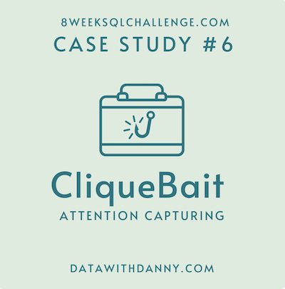
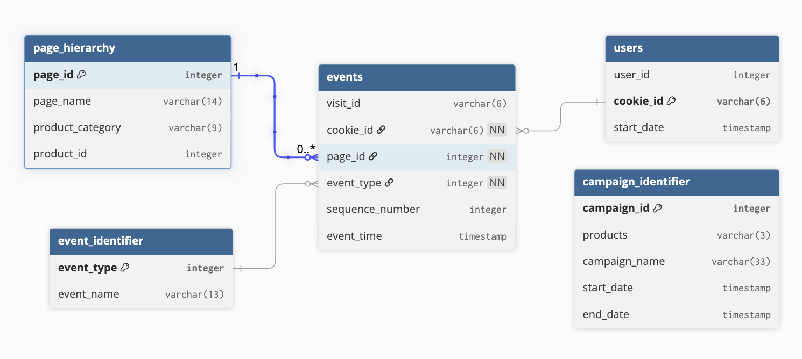

# October 14 - Clique Bait


## Tables and Data Structure


## Question and Solution
All queries are written in PostgreSQL.

***
### Case Study Questions
1. How many users are there?

```sql
SELECT 
	COUNT(DISTINCT user_id) 
FROM 
	clique_bait.users;
```
Output:
| count |
| ----- |
| 500   |
***
2. What range of week numbers are missing from the dataset?
```sql
WITH cookie_counts AS (
SELECT
	COUNT(DISTINCT cookie_id) AS cookie_count
FROM
	clique_bait.users
GROUP BY
	user_id
)
SELECT
	ROUND(AVG(cookie_count),2) AS avg_cookie_count
FROM
	cookie_counts;
```
Output:
| avg_cookie_count |
| ---------------- |
| 3.56             |

Data is recorded during months March to September.
***
3. How many total transactions were there for each year in the dataset?

```sql
SELECT 
	EXTRACT(MONTH FROM event_time) AS month,
	COUNT(DISTINCT visit_id) AS num_visits
FROM
	clique_bait.events
GROUP BY
	month
ORDER BY 
	month;
```
Output:
| month | num_visits |
| ----- | ---------- |
| 1     | 876        |
| 2     | 1488       |
| 3     | 916        |
| 4     | 248        |
| 5     | 36         |

Years 2019 and 2020 have the most transactions, with a significant jump of ~20 million occurring between 2018 and 2019.
***
4. What is the total sales for each region for each month?
```sql
SELECT
	eId.event_type,
	eId.event_name,
	COUNT(*) AS num_events
FROM
	clique_bait.events e
INNER JOIN
	clique_bait.event_identifier eId
    ON e.event_type = eId.event_type
GROUP BY
	eId.event_type, eId.event_name
ORDER BY
	eId.event_type;
```
Output:
| event_type | event_name    | num_events |
| ---------- | ------------- | ---------- |
| 1          | Page View     | 20928      |
| 2          | Add to Cart   | 8451       |
| 3          | Purchase      | 1777       |
| 4          | Ad Impression | 876        |
| 5          | Ad Click      | 702        |
***
5. What is the total count of transactions for each platform?

```sql
SELECT
	(SELECT COUNT(DISTINCT visit_id) FROM clique_bait.events) AS total_visits,
    COUNT(DISTINCT visit_id) AS num_purchase_events,
    ROUND(100*CAST(COUNT(DISTINCT visit_id) AS NUMERIC)/(SELECT COUNT(DISTINCT visit_id) FROM clique_bait.events),2) AS purchase_percentage
FROM
	clique_bait.events e
INNER JOIN
	clique_bait.event_identifier eId
    ON e.event_type = eId.event_type
WHERE
	eId.event_name = 'Purchase';
```
Output:
| total_visits | num_purchase_events | purchase_percentage |
| ------------ | ------------------- | ------------------- |
| 3564         | 1777                | 49.86               |
***
6. What is the percentage of sales for Retail vs Shopify for each month?

```sql
WITH base AS (
SELECT 
  visit_id,
  MAX(CASE 
  	WHEN event_type = 1 AND page_id = 12 THEN 1 
    ELSE 0 
  END) AS checkout,
  MAX(CASE 
  	WHEN event_type = 3 THEN 1 
    ELSE 0 
  END) AS purchase
FROM 
	clique_bait.events
GROUP BY
	visit_id
)
SELECT
	ROUND(100*CAST(SUM(CASE WHEN checkout = 1 AND purchase = 0 THEN 1 ELSE 0 END) AS NUMERIC)/(SELECT COUNT(DISTINCT visit_id) FROM clique_bait.events),2) AS percentage_view_checkout_no_purchase
FROM
	base;
```
Output:

| percentage_view_checkout_no_purchase |
| ------------------------------------ |
| 9.15                                 |
***
7. What is the percentage of sales by demographic for each year in the dataset?

```sql
SELECT
	pId.page_id,
    pId.page_name,
    SUM(CASE WHEN eId.event_name = 'Page View' THEN 1 ELSE 0 END) as num_views
FROM
	clique_bait.events e 
INNER JOIN
	clique_bait.event_identifier eId
    ON e.event_type = eId.event_type
INNER JOIN
	clique_bait.page_hierarchy pId
    ON e.page_id = pId.page_id
GROUP BY
	pId.page_id, pId.page_name
ORDER BY 
	num_views DESC
LIMIT 3;
```
Output:
| page_id | page_name    | num_views |
| ------- | ------------ | --------- |
| 2       | All Products | 3174      |
| 12      | Checkout     | 2103      |
| 1       | Home Page    | 1782      |
***
Note: The context of this case study is sourced from the [challenge website](https://8weeksqlchallenge.com/case-study-6/) by Danny Ma.