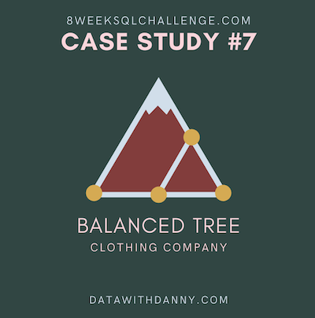

# October 21 - Balanced Tree Clothing Co.


## Tables and Data Structure
```sql
-- Types of Clothing
CREATE TABLE balanced_tree.product_details (
  "product_id" VARCHAR(6),
  "price" INTEGER,
  "product_name" VARCHAR(32),
  "category_id" INTEGER,
  "segment_id" INTEGER,
  "style_id" INTEGER,
  "category_name" VARCHAR(6),
  "segment_name" VARCHAR(6),
  "style_name" VARCHAR(19)
);
-- Transactions Table
CREATE TABLE balanced_tree.sales (
  "prod_id" VARCHAR(6),
  "qty" INTEGER,
  "price" INTEGER,
  "discount" INTEGER,
  "member" BOOLEAN,
  "txn_id" VARCHAR(6),
  "start_txn_time" TIMESTAMP
);
```

## Question and Solution
All queries are written in PostgreSQL.

***
### Case Study Questions
1. Total quantity sold for all products?

```sql
SELECT
	d.product_name,
	SUM(s.qty) AS total_quantity
FROM
	balanced_tree.product_details d
INNER JOIN
	balanced_tree.sales s
    ON d.product_id=s.prod_id
GROUP BY
	d.product_name;
```
Output:
| product_name                     | total_quantity |
| -------------------------------- | -------------- |
| White Tee Shirt - Mens           | 3800           |
| Navy Solid Socks - Mens          | 3792           |
| Grey Fashion Jacket - Womens     | 3876           |
| Navy Oversized Jeans - Womens    | 3856           |
| Pink Fluro Polkadot Socks - Mens | 3770           |
| Khaki Suit Jacket - Womens       | 3752           |
| Black Straight Jeans - Womens    | 3786           |
| White Striped Socks - Mens       | 3655           |
| Blue Polo Shirt - Mens           | 3819           |
| Indigo Rain Jacket - Womens      | 3757           |
| Cream Relaxed Jeans - Womens     | 3707           |
| Teal Button Up Shirt - Mens      | 3646           |
***
2. What is the total generated revenue for all products before discounts?
```sql
SELECT
	d.product_name,
    SUM(s.qty * s.price) AS total_revenue
FROM
	balanced_tree.product_details d
INNER JOIN
	balanced_tree.sales s
    ON d.product_id=s.prod_id
GROUP BY
	d.product_name;
```
Output:
| product_name                     | total_revenue |
| -------------------------------- | ------------- |
| White Tee Shirt - Mens           | 152000        |
| Navy Solid Socks - Mens          | 136512        |
| Grey Fashion Jacket - Womens     | 209304        |
| Navy Oversized Jeans - Womens    | 50128         |
| Pink Fluro Polkadot Socks - Mens | 109330        |
| Khaki Suit Jacket - Womens       | 86296         |
| Black Straight Jeans - Womens    | 121152        |
| White Striped Socks - Mens       | 62135         |
| Blue Polo Shirt - Mens           | 217683        |
| Indigo Rain Jacket - Womens      | 71383         |
| Cream Relaxed Jeans - Womens     | 37070         |
| Teal Button Up Shirt - Mens      | 36460         |
***
3. What was the total discount amount for all products?

```sql
SELECT
	d.product_name,
	ROUND(SUM(CAST(s.discount AS NUMERIC)/100 * s.price * s.qty),2) AS discount_amount
FROM
	balanced_tree.product_details d
INNER JOIN
	balanced_tree.sales s
    ON d.product_id=s.prod_id
GROUP BY
	d.product_name;
```
Output:
| product_name                     | discount_amount |
| -------------------------------- | --------------- |
| White Tee Shirt - Mens           | 18377.60        |
| Navy Solid Socks - Mens          | 16650.36        |
| Grey Fashion Jacket - Womens     | 25391.88        |
| Navy Oversized Jeans - Womens    | 6135.61         |
| Pink Fluro Polkadot Socks - Mens | 12952.27        |
| Khaki Suit Jacket - Womens       | 10243.05        |
| Black Straight Jeans - Womens    | 14744.96        |
| White Striped Socks - Mens       | 7410.81         |
| Blue Polo Shirt - Mens           | 26819.07        |
| Indigo Rain Jacket - Womens      | 8642.53         |
| Cream Relaxed Jeans - Womens     | 4463.40         |
| Teal Button Up Shirt - Mens      | 4397.60         |
***
4. How many unique transactions were there?
```sql
SELECT
	COUNT(DISTINCT s.txn_id) AS unique_transactions
FROM
	balanced_tree.sales s;
```
Output:
| unique_transactions |
| ------------------- |
| 2500                |
***
5. What is the average unique products purchased in each transaction?

```sql
WITH unique_purchases_per_txn AS (
SELECT
	s.txn_id,
    COUNT(DISTINCT s.prod_id) AS unique_prod_purchased
FROM
	balanced_tree.sales s
GROUP BY
	s.txn_id
)
SELECT
	ROUND(AVG(u.unique_prod_purchased)) AS average_unique_products
FROM
	unique_purchases_per_txn u;
```
Output:
| average_unique_products |
| ----------------------- |
| 6                       |
***
6. What are the 25th, 50th and 75th percentile values for the revenue per transaction?

```sql
WITH revenues_per_txn AS (
SELECT
  	s.txn_id,
  	SUM(s.qty * s.price) AS revenue
FROM
	balanced_tree.sales s
GROUP BY
	s.txn_id
)
SELECT
	percentile_cont(0.25) WITHIN GROUP (ORDER BY r.revenue) AS revenue_25p,
    percentile_cont(0.50) WITHIN GROUP (ORDER BY r.revenue) AS revenue_median,
    percentile_cont(0.75) WITHIN GROUP (ORDER BY r.revenue) AS percentile_75
FROM
	revenues_per_txn r;
```
Output:
| revenue_25p | revenue_median | percentile_75 |
| ----------- | -------------- | ------------- |
| 375.75      | 509.5          | 647           |
***
7. What is the average discount value per transaction?

```sql
WITH discount_per_txn AS (
SELECT
  	s.txn_id,
  	SUM(CAST(s.discount AS NUMERIC)/100 * s.price * s.qty) AS discount_amount
FROM
	balanced_tree.sales s
GROUP BY
	s.txn_id
)
SELECT
	ROUND(AVG(d.discount_amount),2) AS avg_discount_amount
FROM
	discount_per_txn d;
```
Output:
| avg_discount_amount |
| ------------------- |
| 62.49               |
***
8. What is the percentage split of all transactions for members vs non-members?

```sql
SELECT
	ROUND(100*COUNT(DISTINCT CASE WHEN s.member='t' THEN s.txn_id ELSE NULL END)/CAST(COUNT(DISTINCT txn_id) AS NUMERIC),2) AS member_txn_percentage,
    ROUND(100*COUNT(DISTINCT CASE WHEN s.member='f' THEN s.txn_id ELSE NULL END)/CAST(COUNT(DISTINCT txn_id) AS NUMERIC),2) AS nonmember_txn_percentage
FROM
	balanced_tree.sales s;
```
Output:
| member_txn_percentage | nonmember_txn_percentage |
| --------------------- | ------------------------ |
| 60.20                 | 39.80                    |
***
9. What is the average revenue for member transactions and non-member transactions?

```sql
WITH revenue AS (
SELECT
  	s.txn_id,
  	s.member,
  	SUM(s.qty * s.price * (1-CAST(s.discount AS NUMERIC)/100)) AS revenue_after_discounts
FROM
	balanced_tree.sales s
GROUP BY
	s.txn_id, s.member
)
SELECT
	ROUND(AVG(CASE WHEN r.member='t' THEN r.revenue_after_discounts ELSE NULL END), 2) AS member_txn_avg_revenue,
    ROUND(AVG(CASE WHEN r.member='f' THEN r.revenue_after_discounts ELSE NULL END), 2) AS nonmember_txn_avg_revenue
FROM
	revenue r;
```
Output:
| member_txn_avg_revenue | nonmember_txn_avg_revenue |
| ---------------------- | ------------------------- |
| 454.14                 | 452.01                    |
***
Note: The context of this case study is sourced from the [challenge website](https://8weeksqlchallenge.com/case-study-7/) by Danny Ma.